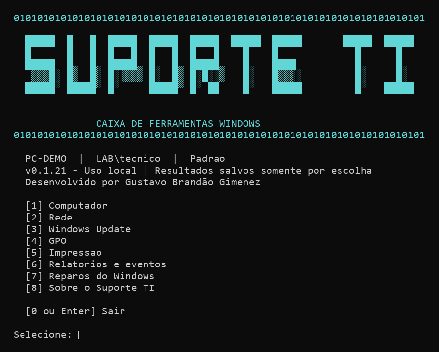

# Ferramenta de Suporte Windows

Caixa de ferramentas local e portatil para Windows 10/11, escrita em Windows PowerShell 5.1. Menu textual, diagnosticos com limites de duracao e intervencoes selecionadas pelo tecnico.

**[Baixar Suporte TI CLI v0.1.23 (ZIP portatil)](https://github.com/gustavo-brandao/SuporteTI/releases/download/v0.1.23/SuporteTI-CLI-0.1.23-portatil.zip)**

Versao do codigo na branch `main`: [**0.1.23**](Modulos/SuporteTI.psd1#L3). As [notas e o SHA-256 da v0.1.23](https://github.com/gustavo-brandao/SuporteTI/releases/tag/v0.1.23) e o [historico de versoes](https://github.com/gustavo-brandao/SuporteTI/releases) ficam em **Releases**.



## Abrir

1. Extraia todo o ZIP em uma pasta no pendrive ou no computador.
2. Abra **Suporte TI.exe**, identificado pelo nome e pelo icone de terminal. A ferramenta abre com as permissoes da sessao atual.
3. Digite o numero do grupo ou da opcao e pressione Enter. **0 ou Enter vazio** volta nos menus e sai no menu principal. Nos campos que indicam um valor padrao, como o destino de um relatorio, Enter usa esse valor.

Para levar a ferramenta para outra unidade, copie a pasta inteira. O executavel encontra os modulos na pasta do pacote, independentemente da letra do pendrive. O pacote tambem inclui **Iniciar.cmd** para abertura direta pelo iniciador de linha de comando.

Tambem e possivel iniciar em um Windows PowerShell permitido pela instituicao:

```powershell
.\Iniciar.ps1
# Opcional: cores do terminal, sem destaque colorido
.\Iniciar.ps1 -SemCores
```

A distribuicao de desenvolvimento ainda nao esta assinada. O iniciador e a janela elevada usam **RemoteSigned somente no processo que abrem**, sem alterar a politica persistente do usuario ou computador. Quando todos os scripts de `Modulos` tem assinatura Authenticode valida, a janela elevada passa a exigir **AllSigned**. Nao usam Bypass nem desbloqueiam arquivos automaticamente. Restricoes de GPO continuam prevalecendo. Se a instituicao bloquear scripts, sera necessario homologar e assinar a distribuicao (veja **Compilar e assinar**) e autorizar sua execucao pelos mecanismos institucionais.

Se o Windows informar que um script nao esta assinado por ter vindo da internet, confira a procedencia do ZIP; nas propriedades do ZIP confiavel, use Desbloquear antes de extrair novamente. Isso remove a marcacao de origem do arquivo, nao uma restricao por GPO. Nao desbloqueie arquivos de procedencia desconhecida. Em redes que exigem AllSigned ou bloqueiam scripts, solicite a autorizacao institucional.

O smartctl incluido e x64. Em Windows de 32 bits ou controladoras nao compativeis, a consulta detalhada pode ficar indisponivel; os dados nativos continuam sendo apresentados quando acessiveis.

## Menu

| Grupo | Opcoes |
|---|---|
| Computador | Informacoes do Windows com CPU e RAM; resumo de cinco processos por memoria; monitor de CPU/RAM com barras ao vivo; ocupacao e saude dos discos internos; mapa de ocupacao do disco; login automatico do Windows; consulta de discos com elevacao; dispositivos com problema; servicos; programas instalados; diagnostico de falhas recentes; limpeza do cache HTTP do Chrome; secao Notebook com a opcao de saude da bateria sempre visivel. |
| Rede | ipconfig /all; nome da maquina, ingresso e dominio; ping com resultado em destaque; estimativa de download e upload; troca de IPv4 para DHCP ou configuracao manual com mascara, gateway e um ou dois DNS. |
| Windows Update | Diagnostico de servicos, politicas, espaco, reinicio pendente e eventos; recriar somente o cache de download. |
| GPO | gpresult do usuario; gpresult do computador com elevacao; HTML por escopo usuario/computador; gpupdate separado por usuario/computador, com /force opcional. |
| Impressao | Diagnosticar as filas visiveis na sessao e identificar por nome a impressora com problema; reiniciar spooler local, sem remover trabalhos. |
| Relatorios e eventos | Eventos recentes de Application/System; rever e salvar ultimo resultado da sessao; exportar Application/System/Setup das ultimas 24h em EVTX com manifesto SHA256. |
| Reparos | SFC /verifyonly ou /scannow; DISM CheckHealth, ScanHealth ou RestoreHealth; CHKDSK de consulta e completo com /f /r. |

O menu principal usa letras de bloco em janelas com pelo menos 72 colunas. Em janelas estreitas ou com `-SemCores`, usa um titulo compacto. Cada grupo, submenu, etapa de codigo e consulta abre sua propria tela no console interativo. Saidas redirecionadas preservam a sequencia das telas. As opcoes seguem ordem numerica dentro dos grupos. Os resultados quebram linhas conforme a largura do console e os discos usam blocos com motivo, percentual e barra alinhados.

**Desenvolvido por Gustavo Brandão Gimenez.** O credito aparece no menu inicial, na opcao **[8] Sobre o Suporte TI** e nas propriedades do executavel, em **Detalhes**.

A tela **Sobre** apresenta a versao do aplicativo, o ano de 2026 e o credito de desenvolvimento.

Titulos e informacoes de leitura usam ciano. Secoes administrativas e acoes de alteracao usam amarelo, com rotulos em texto. As cores recebem tons mais escuros em fundos claros. Ping usa texto e cor para indicar resposta, perda parcial ou falta de resposta. Discos mostram uma barra de ocupacao por volume. GPO e Eventos exibem os comandos na tela da consulta ou operacao.

Em **Reparos**, a opcao **Verificar e remover perfil local duplicado** exibe a conta, o SID e os caminhos encontrados. A exclusao exige confirmacao apos o aviso de perda de arquivos e configuracoes locais. Antes de aceitar, confira o backup ou a pasta compartilhada. Perfis carregados e pastas de associacao duvidosa ficam bloqueados. O reinicio tem uma pergunta separada apos a verificacao da exclusao.

O pacote atual e a edicao publica e generica. Recursos exclusivos de redes da UCDB pertencem a uma futura edicao fechada.

A listagem em **Relatorios e eventos** cobre as ultimas 24h, com ate 30 eventos por canal. O relatorio de Update inclui as mensagens retornadas pelo Windows, que podem conter KB e codigos de erro. O monitor atualiza barras no console a cada leitura e volta com Q, Esc ou Enter. O resumo do Windows oferece uma amostra para salvar no relatorio.

Em **Computador > Falhas recentes e codigos de erro > [1] Analisar os ultimos erros e travamentos**, a triagem das ultimas 24h procura a ocorrencia mais recente entre telas azuis, reinicios, desligamentos solicitados e falhas ou travamentos de aplicativos. Se nao encontrar uma dessas ocorrencias, resume o registro de erro ou alerta relevante mais recente. O resultado explica o ocorrido em portugues, sugere onde investigar quando ha evidencia e lista ate quatro registros relevantes nos 15 minutos anteriores ao horario de referencia. Os detalhes preservam horario, provedor, ID e codigo de parada quando disponivel. A consulta funciona offline e em modo somente leitura, com ate 80 registros por filtro. Eventos do reinicio podem ser gravados somente na inicializacao seguinte. O evento 41 sem codigo indica desligamento irregular com causa indeterminada. Quando o Windows informa que gravou um dump, o resumo sinaliza sua existencia no registro. A triagem interpreta os logs e nao abre o conteudo do dump. [Referencia da Microsoft sobre reinicios](https://learn.microsoft.com/en-us/troubleshoot/windows-server/performance/troubleshoot-unexpected-reboots-system-event-logs) e [catalogo de codigos de parada](https://learn.microsoft.com/en-us/windows-hardware/drivers/debugger/bug-check-code-reference2).

Para falhas de aplicativos, o resumo traduz os codigos de excecao conhecidos e mostra o aplicativo, o codigo e o modulo quando registrados pelo Windows. O modulo indica onde a falha foi registrada e serve como pista para a investigacao. Se um codigo estiver fora do catalogo local, o resultado preserva o valor e informa que a descricao esta indisponivel. [Referencia da Microsoft sobre falhas de aplicativos](https://learn.microsoft.com/pt-br/troubleshoot/windows-server/performance/troubleshoot-application-service-crashing-behavior).

A analise automatica tambem lista ate seis codigos distintos encontrados nos registros consultados, alem do codigo da ocorrencia principal quando houver. Para cada codigo, mostra data, origem e explicacao quando disponivel. A lista usa os campos de parada, excecao de aplicativo, NTSTATUS, Win32 e HRESULT identificados no registro. O ID do evento fica nos detalhes e um registro sem codigo de falha identificado, mesmo que seja o mais recente, nao impede a busca pelos demais.

Selecione o numero ao lado de um dos codigos encontrados para abrir a explicacao completa. A triagem preenche o codigo e usa a familia identificada no evento. Na mesma lista, use **S** para salvar o relatorio ou **0** ou **Enter** para voltar ao submenu.

O [catalogo de falhas](Modulos/CatalogoFalhas.json) acompanha o pacote e pode ser consultado offline. Contem 9.608 entradas em cerca de 955 KB, separadas nas familias `Paradas`, `Excecoes` (NTSTATUS e excecao CLR), `Win32` e `HRESULT`. Cada entrada tem codigo, nome tecnico e fonte oficial. As 51 entradas com texto proprio tambem oferecem explicacao e pista de investigacao. Nas demais, o Suporte TI tenta ler a mensagem em portugues do proprio Windows para NTSTATUS, Win32 e HRESULT. Quando ela nao esta disponivel, o resultado conserva o nome tecnico e a referencia que estiverem no catalogo. Se o arquivo estiver indisponivel, a triagem continua exibindo os eventos e codigos.

No mesmo submenu, **[2] Consultar um codigo de erro** pede apenas o codigo decimal, decimal negativo de 32 bits ou hexadecimal com prefixo `0x`. A pesquisa verifica as familias automaticamente e mostra os significados encontrados. Se houver mais de uma correspondencia, use a origem do erro para interpretar o resultado. Para acrescentar uma entrada ao JSON, mantenha oito digitos hexadecimais sem `0x` e vincule o codigo a uma fonte em `Fontes`.

## Seguranca e comportamento

- Atua somente na maquina aberta. Nao executa comandos livres ou em destinos remotos.
- O impacto e apresentado antes das alteracoes. A configuracao e a desativacao do login automatico pedem confirmacao explicita. Quando a operacao requer elevacao, a conta deve ter direitos nessa estacao.
- Usuario/GPO do usuario nao sao consultados sob outra conta. Operacoes administrativas usam o console atual se ele ja estiver elevado. Caso contrario, quando necessario, o Windows abre um console separado via UAC.
- Janela elevada: ao abrir, o Suporte TI registra uma impressao SHA256 dos arquivos de `Modulos`, da DLL e do smartctl. A janela elevada copia os arquivos para uma pasta em `Windows\Temp` acessivel somente a Administradores e SYSTEM. A copia preserva a marca de origem do Windows e o hash e conferido no destino antes da execucao. Mudancas de conteudo, inclusoes ou remocoes de arquivos depois da abertura bloqueiam a operacao. A copia e removida ao terminar. A impressao protege contra alteracoes posteriores a abertura do pacote.
- Para abrir a janela elevada a partir de uma pasta compartilhada (UNC ou unidade de rede), os scripts do pacote precisam ter assinatura Authenticode valida. Essa exigencia vale tambem na copia protegida. A conta usada no UAC deve ter acesso de leitura ao caminho original.
- GPO pode exigir credenciais, apenas consentimento, ou impedir elevacao. A credencial usada para elevar a sessao e tratada pelo proprio Windows.
- Nao limpa logs, nao esvazia lixeira, nao encerra programas para liberar RAM, nao altera proxy, antivirus ou permissoes.
- Nao instala servicos, nao cria auditoria propria nem pasta em ProgramData. A unica pasta criada fora do destino escolhido e a copia temporaria da janela elevada em `Windows\Temp`, removida ao fechar essa janela. Comandos do Windows produzem seus logs nativos normalmente.
- Cache do Update: bloqueia se detectar manutencao ativa ou reinicializacao pendente; para BITS/wuauserv quando necessario; renomeia apenas Download; restaura os estados de execucao anteriores. O cache anterior permanece no disco, sem exclusao automatica. Nao faz reset de DataStore/catroot2, nao desinstala atualizacoes e nao inicia download automaticamente.
- Consultas comuns: limite de 25s; discos: 40s no total, ate quatro dispositivos SMART. A consulta nativa pode fornecer resultados parciais. SFC, DISM, CHKDSK e gpupdate rodam ate o encerramento do comando nativo.
- O uso de disco mostra total, usado, livre e percentual de ocupacao por volume local. O CHKDSK permite escolher um volume local com letra. No modo completo, o proprio Windows pode oferecer agendamento para o proximo reinicio. O tecnico reinicia manualmente se tiver aceitado o agendamento.
- **Mapa de ocupacao do disco** abre uma janela grafica do Suporte TI, offline. Escolha um volume fixo local. O total, o espaco usado e o espaco livre vem do Windows. O mapa mostra retangulos coloridos por tamanho logico dos arquivos e pastas acessiveis, com lista dos maiores. Use duplo clique para entrar em uma pasta e **Pasta anterior** para subir um nivel. A leitura ignora juncoes, links e entradas inacessiveis, e sinaliza resultados parciais quando aplicavel. Ela pode ser cancelada e tem limites de 350 mil entradas, 90 segundos verificados entre leituras e 64 niveis. O tamanho somado no mapa pode divergir da ocupacao medida pelo Windows.
- **Login automatico do Windows** consulta o estado e oferece configurar ou desativar para uma conta local ou de dominio. A senha e digitada de forma oculta no console elevado e gravada como segredo LSA do Windows. Ela nao aparece no Registro como texto simples, na linha de comando nem no relatorio do Suporte TI. Administradores locais podem recuperar esse segredo. Configure somente em equipamento com acesso fisico controlado e use uma conta dedicada. A ferramenta impede sobrepor uma configuracao ativa ou legada. O login depende das politicas do Windows e deve ser conferido apos a proxima inicializacao. Consulte [Microsoft Sysinternals Autologon](https://learn.microsoft.com/en-us/sysinternals/downloads/autologon).
- A limpeza do Chrome exige o navegador fechado e a sessao comum do usuario. O escopo e a pasta Cache dos perfis Default e Profile N na localizacao padrao do Chrome. Historico, cookies e senhas permanecem nos perfis. Pastas redirecionadas e arquivos inacessiveis sao ignorados.
- Saude dos discos internos: uma linha por HDD ou SSD, com **Troca recomendada**, **Atencao - avaliar troca**, **Sem alertas detectados** ou **Inconclusivo**, motivo e desgaste estimado quando disponivel. O percentual informa quanto da resistencia nominal do SSD foi usado. Ele pode ultrapassar 100% em NVMe e o limite estimado sozinho sinaliza atencao. A consulta cruza SMART e o Windows, preserva alertas em leituras parciais e cobre ate quatro discos ATA, SATA, SAS ou NVMe identificados pelo Windows. USB e RAID ficam fora da consulta de saude. A leitura e pontual, sem iniciar autotestes ou reparos. Discos ATA em repouso podem aparecer como inconclusivos.
- A porcentagem e a barra de desgaste se aplicam a SSDs com indicador disponivel. Em HDDs, a recomendacao usa sinais como falhas SMART e setores problematicos. Em SSDs, o Suporte TI sinaliza **Atencao** a partir de 80% de desgaste estimado para orientar o planejamento de troca preventiva.
- Em SSDs SATA, o desgaste depende dos indicadores SMART interpretados para o modelo ou do contador do Windows quando o SSD e identificado. No Kingston A400, a regra usa o atributo E7 de acordo com o firmware. Em NVMe, a consulta usa o registro de saude do protocolo. Alerta de temperatura, reserva baixa ou erros de integridade da midia sinalizam **Atencao**. Perda de confiabilidade ou midia somente leitura sinalizam **Troca recomendada**.
- No console, o resultado do disco e a barra de desgaste usam azul para **Sem alertas detectados**, amarelo para **Atencao**, vermelho para **Troca recomendada** e cinza para **Inconclusivo**. Quando o desgaste esta disponivel, a barra representa a resistencia usada ate 100%, e o texto distingue o percentual usado do restante. Com `-SemCores`, a barra e os textos aparecem sem destaque, inclusive na consulta com acesso administrativo.
- Notebook: **Saude da bateria** mostra a capacidade maxima atual em relacao a original, como `80% da capacidade original (40 Wh de 50 Wh)`, com uma barra azul por bateria quando a porcentagem esta disponivel. A barra representa a capacidade relativa ate 100% e o texto exibe o valor real. Em desktops sem bateria interna, o menu informa que a consulta nao se aplica. O relatorio XML temporario do Windows e removido ao fim da consulta. O salvamento opcional guarda o resumo.
- Impressao: o diagnostico lista nome, porta, estado informado pelo Windows e contagem de trabalhos por fila. Sinaliza impressoras e trabalhos com erro, pausa ou outros avisos informados pelo Windows. Filas sem acesso ficam como indisponiveis. Se o spooler estiver parado, o resultado identifica o servico e informa que as filas nao puderam ser avaliadas. A consulta nao reinicia o servico, nao remove trabalhos e nao exibe titulos de documentos.
- Ping: quatro tentativas ICMP para o host ou IP informado. O teste de velocidade mede amostras HTTPS de 8 MiB de download e 4 MiB de upload para a Cloudflare. O resultado depende da rota e do servidor testado. A consulta de proxy WinHTTP fica no diagnostico do Windows Update.
- A troca para DHCP restaura IPv4 e DNS IPv4 automaticos no adaptador escolhido. A selecao mostra o nome, o estado e o endereco atual de cada adaptador. O modo fixo solicita IPv4, mascara ou prefixo, gateway opcional, DNS primario e DNS secundario opcional. Essas operacoes podem interromper a conexao, inclusive durante suporte remoto. O menu mostra o estado antes e apos a alteracao.
- Dispositivos com codigo 24 ficam ocultos quando o Windows confirma que estao ausentes. Os demais dispositivos com problema aparecem no diagnostico.
- A consulta Dominio exibe somente `Name`, `PartOfDomain` e `Domain`. O ingresso registrado e o nome do dominio podem ser verificados mesmo com o controlador indisponivel.

Os arquivos portateis devem vir de fonte confiavel. A confirmacao UAC nao autentica o conteudo de um script. A impressao registrada na abertura protege a janela elevada contra alteracoes posteriores, mas nao contra um pacote ja adulterado antes de ser aberto; para distribuicao em producao, o projeto ainda precisa de assinatura e homologacao institucional. O manifesto SHA256 do smartctl detecta divergencias em relacao ao pacote, mas nao e fronteira de seguranca contra quem pode alterar todo o projeto.

## Resultados

Resultados de consultas ficam em memoria ate serem substituidos ou ate fechar o programa. No prompt de salvamento, Enter equivale a N. O destino sugerido e:

```text
Documentos\SuporteTI\Resultados\COMPUTADOR\DATA_HORA_IDENTIFICADOR\
```

E possivel selecionar outro caminho absoluto, inclusive pendrive ou compartilhamento. Cada salvamento cria uma pasta unica e nao sobrescreve resultados anteriores. Acesso negado permite escolher outro destino no salvamento textual. Exportacoes informam erros e podem deixar arquivos parciais identificaveis no destino.

No processo elevado, o destino sugerido e recebido da sessao original, evitando sugerir Documentos da conta administrativa. O Windows ainda pode negar acesso ao destino; escolha uma pasta autorizada. Nao ha alteracao automatica de ACLs. Relatorios podem conter informacoes internas: escolha o destino e as permissoes adequados.

Os reparos exibem a saida nativa ao vivo. O resultado textual opcional registra o resumo da operacao, sem transcrever automaticamente todo o console; detalhes permanecem nos logs nativos CBS/DISM. A interface principal nao recupera o resultado em memoria do processo elevado.

## Estrutura

```text
Suporte TI.exe                Iniciador portatil com icone embutido
Iniciar.cmd / Iniciar.ps1      Entrada do menu PowerShell
Modulos\SuporteTI.psm1         Menu, consultas limitadas e salvamento
Modulos\Consultas.ps1          Coletores de leitura
Modulos\Operacoes.ps1          Acoes restritas, exportacoes e entrada verificada da janela elevada
Modulos\Elevado.ps1            Acoes permitidas na janela UAC, executado da copia conferida
Modulos\Discos.ps1             SMART/NVMe e classificacao
Modulos\Logon.ps1              Consulta e configuracao do login automatico
Modulos\Falhas.ps1             Triagem de travamentos, reinicios e telas azuis
Modulos\CatalogoFalhas.json    Explicacoes e fontes dos codigos de falha
Recursos\SuporteTI.Windows.dll Mapa grafico e acesso nativo ao segredo LSA
Ferramentas\smartmontools\     smartctl 7.5, base, licenca e fonte
Testes\Executar-Testes.ps1     Testes e cobertura por opcao
Construcao\Compilar.ps1        Compila o executavel e a DLL a partir de Recursos\*.cs
Construcao\Assinar.ps1         Assina scripts e binarios de uma copia de distribuicao
.github\workflows\testes.yml   CI: compilacao e testes no Windows PowerShell 5.1
```

## Compilar e assinar

`Suporte TI.exe` e `Recursos\SuporteTI.Windows.dll` sao gerados a partir dos arquivos `.cs` de `Recursos` com o `csc.exe` do .NET Framework 4.x, presente no Windows. Nao e necessario Visual Studio:

```powershell
.\Construcao\Compilar.ps1                     # grava sobre os binarios do pacote
.\Construcao\Compilar.ps1 -Destino C:\saida   # grava em outra pasta
```

O script recusa compilar se a versao em `Recursos\Iniciador.cs` divergir da versao de `Modulos\SuporteTI.psd1` e exibe o SHA256 dos arquivos gerados. O compilador do .NET Framework nao produz binarios byte a byte identicos entre compilacoes; a conferencia e feita recompilando a partir do codigo-fonte.

Para assinar, use um certificado de assinatura de codigo confiavel nas estacoes atendidas e assine a pasta que sera compactada no ZIP, nao o clone do git, cuja conversao de fim de linha invalida as assinaturas:

```powershell
.\Construcao\Assinar.ps1 -Pacote D:\Distribuicao\SuporteTI -Impressao <thumbprint>
```

Sao assinados `Iniciar.ps1`, os scripts de `Modulos`, a DLL e o executavel. O smartctl e de terceiros e nao e assinado pelo script.

## Testes

Os testes simulam as intervencoes e nao reiniciam servicos nem executam reparos reais. Criam apenas arquivos de teste sob work e o relatorio em Testes. Em um Windows PowerShell com execucao autorizada:

```powershell
.\Testes\Executar-Testes.ps1
.\Testes\Executar-Testes.ps1 -IncluirConsultasReais
```

No GitHub, cada pull request e cada envio para `main` recompilam o executavel e a DLL na pasta do pacote. A suite simulada roda em Windows PowerShell 5.1 com os binarios dessa compilacao. O `resultado-testes.json` fica anexado a execucao.

O segundo comando acrescenta consultas reais somente leitura. Acesso negado e falta de dominio/hardware sao resultados possiveis; um smoke test aprovado verifica o contrato de retorno e nao significa que todos os dados estavam disponiveis. Consulte **Testes/resultado-testes.json** e **Testes/VALIDACAO.md**.

Homologacao real de UAC com outra conta, login automatico apos reiniciar, Active Directory/GPO, dispositivos variados, impressao e reparos deve ocorrer em maquinas de teste.

## Origem, licença e terceiros

Inspirado na proposta de [felipewehcode/Suporte_TI](https://github.com/felipewehcode/Suporte_TI), com implementacao independente.

O código próprio da edição pública é licenciado sob a [licença MIT](LICENSE). Copyright © 2026 Gustavo Brandão Gimenez.

O componente [smartmontools 7.5](https://github.com/smartmontools/smartmontools/releases/tag/RELEASE_7_5) e distribuido separadamente sob sua licenca GPL-2.0-ou-posterior. O pacote contem a licenca, avisos, documentacao e arquivo-fonte original correspondente. Consulte **TERCEIROS.md**. Nao redistribua somente o executavel sem os arquivos de licenca e fonte do pacote.
